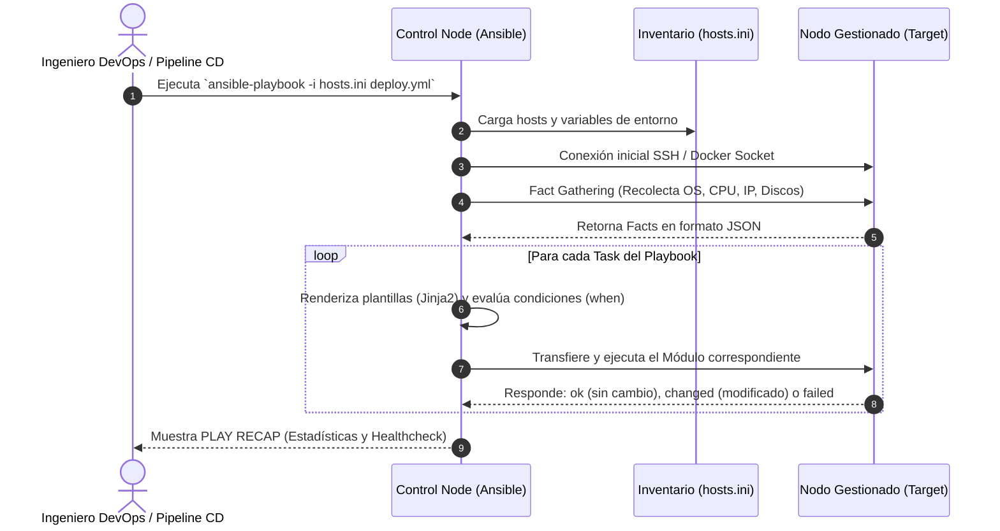

# INFORME TÉCNICO DE INVESTIGACIÓN: ANSIBLE EN PIPELINES DE ENTREGA CONTINUA (CD)

**Asignatura:** Integración de Sistemas  
**Actividad:** Configuración de un pipeline de entrega continua (Herramientas CD) – 10% P1  
**Estudiantes:** Andrew Vilcacundo & Galindo  
**Fecha:** Noviembre 2026  
**Carrera:** Ingeniería de Software  

---

## RESUMEN EJECUTIVO

En el paradigma moderno de Ingeniería de Software y DevOps, la rapidez y fiabilidad en la entrega de valor dependen críticamente de la eliminación de tareas manuales propensas al error humano. **Ansible**, un proyecto de código abierto respaldado corporativamente por **Red Hat**, se ha posicionado como el estándar *de facto* para la gestión de configuraciones, orquestación y entrega continua (*Continuous Delivery* / CD). Este informe presenta un análisis exhaustivo sobre los fundamentos teóricos, la arquitectura *agentless*, la sintaxis declarativa basada en YAML, las comparativas técnicas frente a otras soluciones del mercado (Terraform, Puppet, Chef, SaltStack) y su integración en pipelines modernos de CI/CD junto a Git, Docker y Kubernetes. Adicionalmente, se documenta la implementación y validación empírica de un pipeline de despliegue automatizado e idempotente sobre un entorno real en Windows 11 utilizando contenedores Docker.

---

## 1. ¿QUÉ ES ANSIBLE Y PARA QUÉ SIRVE?

**Ansible** es una herramienta de automatización de TI, aprovisionamiento, gestión de configuración y despliegue de aplicaciones de código abierto desarrollada originalmente por Michael DeHaan en 2012 y adquirida por Red Hat en 2015.

A diferencia de las herramientas tradicionales de gestión de sistemas que requerían la instalación de agentes demonio permanentes y la apertura de puertos especializados en cada máquina objetivo, Ansible fue diseñado bajo la premisa de la **simplicidad radical**:
- **Despliegue de software:** Automatiza la instalación, actualización y configuración de aplicaciones web, bases de datos y microservicios.
- **Gestión de configuraciones:** Garantiza que cientos de servidores mantengan el mismo estado deseado (parches de seguridad, usuarios, reglas de firewall, archivos de configuración).
- **Orquestación en múltiples niveles:** Coordina secuencias de eventos complejas (por ejemplo: actualizar servidores detrás de un balanceador de carga aplicando despliegues en anillo o *rolling updates* sin interrumpir el servicio).

---

## 2. AUTOMATIZACIÓN DE INFRAESTRUCTURA E INFRAESTRUCTURA COMO CÓDIGO (IaC)

La **Infraestructura como Código (Infrastructure as Code - IaC)** es la práctica de gestionar y aprovisionar la infraestructura informática mediante archivos de definición legibles por máquina y versionables, en lugar de configuraciones físicas interactivas o scripts de shell no estructurados.

### Relación entre IaC y Ansible:
1. **Declaratividad:** En lugar de escribir secuencias imperativas de comandos ("haz esto, luego haz lo otro"), en Ansible se describe el **estado final deseado** ("asegura que el paquete Nginx esté instalado y el servicio activo").
2. **Idempotencia:** Una de las propiedades cardinales de Ansible. Ejecutar un Playbook diez veces sobre un servidor produce exactamente el mismo resultado que ejecutarlo una sola vez. Si el sistema ya se encuentra en el estado deseado, Ansible no realiza operaciones redundantes, previniendo efectos colaterales indeseados.
3. **Auditoría y Versionado:** Los Playbooks de Ansible se almacenan en repositorios Git junto con el código fuente de la aplicación, permitiendo control de versiones (*GitOps*), trazabilidad de cambios mediante *commits* y revisiones de código (*Pull Requests*).

---

## 3. ARQUITECTURA Y COMPONENTES PRINCIPALES

Ansible utiliza una arquitectura centralizada y descentralizada a la vez, sustentada en el protocolo estándar **SSH** (en entornos Linux/Unix) o **WinRM** (en Windows).

```mermaid
graph TD
    subgraph Control_Node["Nodo de Control (Control Node)"]
        CLI[Ansible CLI / Core]
        CFG[ansible.cfg]
        INV[Inventario: hosts.ini]
        PB[Playbooks: YAML]
        MOD[Módulos y Plugins]
    end

    subgraph Managed_Nodes["Nodos Gestionados (Managed Nodes - Agentless)"]
        SRV1[Servidor Web Ubuntu\n(SSH / Python)]
        SRV2[Servidor BD RHEL\n(SSH / Python)]
        SRV3[Host Docker / Contenedores\n(Socket / Docker API)]
        SRV4[Servidor Windows\n(WinRM / PowerShell)]
    end

    CLI -->|Lee| INV
    CLI -->|Ejecuta| PB
    PB -->|Invoca| MOD
    CLI -.->|SSH / Sin agente| SRV1
    CLI -.->|SSH / Sin agente| SRV2
    CLI -.->|Docker Socket| SRV3
    CLI -.->|WinRM / HTTPS| SRV4
```

### Componentes Clave:

1. **Control Node (Nodo de Control):**  
   Es la máquina donde se instala Ansible y desde la cual se ejecutan los comandos y Playbooks. Requiere un sistema operativo tipo Unix (Linux, macOS, o entornos emulados como WSL2 en Windows) y un intérprete de Python. No es posible ejecutar un Control Node directamente de forma nativa en el kernel Win32 de Windows, por lo que se emplean contenedores o WSL.

2. **Managed Nodes (Nodos Gestionados):**  
   Son los dispositivos, máquinas virtuales, instancias de nube o contenedores que Ansible administra. **No requieren ningún software cliente de Ansible preinstalado** (*agentless*); únicamente necesitan un servidor SSH y Python 3 (o PowerShell y WinRM en Windows).

3. **Inventory (Inventario):**  
   Archivo (en formato INI o YAML) que lista las direcciones IP, nombres de host y agrupaciones lógicas de los servidores objetivo, así como las variables específicas asociadas a cada grupo o servidor.

4. **Playbooks:**  
   Archivos de texto escritos en formato **YAML** (*YAML Ain't Markup Language*) que definen las políticas, tareas y configuraciones que deben aplicarse a los nodos gestionados.

5. **Plays y Tasks:**  
   - Un **Play** mapea un grupo específico de hosts del inventario con un conjunto de tareas y roles.
   - Una **Task** es la unidad atómica de acción dentro de un Play. Cada tarea invoca un módulo específico con argumentos determinados.

6. **Modules (Módulos):**  
   Son pequeños programas ejecutables que Ansible envía a los nodos gestionados para realizar el trabajo real (por ejemplo: `apt`, `yum`, `copy`, `template`, `service`, `community.docker.docker_container`). Una vez ejecutados, devuelven un JSON al Control Node y se autodestruyen.

7. **Roles:**  
   Mecanismo de empaquetamiento y modularización que organiza tareas, variables, manejadores (*handlers*), archivos estáticos y plantillas en una estructura de directorios estandarizada (`tasks/`, `handlers/`, `templates/`, `vars/`, `defaults/`, `meta/`), facilitando la reutilización del código.

8. **Collections (Colecciones):**  
   Formato moderno de distribución de contenido de Ansible que agrupa módulos, plugins, roles y documentación bajo un mismo espacio de nombres (por ejemplo, `community.docker`, `amazon.aws`, `kubernetes.core`).

9. **Ansible Galaxy:**  
   Repositorio comunitario y oficial público donde los desarrolladores y fabricantes comparten colecciones y roles reutilizables (`ansible-galaxy install`).

---

## 4. FLUJO BÁSICO DE TRABAJO DE ANSIBLE

El ciclo operativo de Ansible sigue una secuencia lineal, determinista y segura:



1. **Lectura y Parsing:** El Control Node interpreta el Playbook, valida la sintaxis y enlaza las variables del inventario.
2. **Fact Gathering (Recolección de Hechos):** Ansible ejecuta automáticamente el módulo `setup` en el nodo gestionado para descubrir información sobre el hardware, sistema operativo, interfaces de red y variables de entorno.
3. **Generación y Ejecución de Tareas:** Para cada tarea, Ansible empaqueta el módulo de Python correspondiente junto con sus parámetros, lo envía a través del túnel seguro, lo ejecuta localmente en el nodo y captura el código de retorno.
4. **Manejo de Notificaciones (Handlers):** Si una tarea con la directiva `notify` produce un cambio (`changed: true`), Ansible desencadena el *handler* asociado al final del Play (por ejemplo, reiniciar Nginx tras modificar su archivo de configuración).
5. **Reporte (Play Recap):** Muestra el resumen de la ejecución indicando cantidad de tareas ejecutadas, modificadas, fallidas o ignoradas.

---

## 5. CARACTERÍSTICAS DESTACADAS DE ANSIBLE

- **Arquitectura Sin Agente (*Agentless*):** No consume memoria RAM continua ni ciclos de CPU en los servidores gestionados cuando no se están ejecutando tareas; elimina la necesidad de actualizar demonios agentes.
- **Sintaxis en YAML (Human-Readable):** Curva de aprendizaje significativamente menor en comparación con herramientas que exigen lenguajes propietarios (como Puppet DSL o Chef Ruby).
- **Idempotencia Nativa:** Garantiza la convergencia del estado del sistema sin necesidad de programar bifurcaciones condicionales complejas.
- **Motor de Plantillas Jinja2:** Permite la inyección dinámica de variables, filtros, bucles y transformaciones en archivos de configuración.
- **Modularidad y Extensibilidad:** Si no existe un módulo para una tarea específica, es posible programar módulos personalizados en Python o cualquier lenguaje que devuelva JSON.

---

## 6. VENTAJAS Y DESVENTAJAS

| Categoría | Ventajas | Desventajas / Limitaciones |
| :--- | :--- | :--- |
| **Arquitectura** | Sin agentes; mínimo impacto de seguridad en nodos destino; no requiere puertos propietarios. | Requiere que el nodo objetivo tenga Python instalado y SSH funcional. |
| **Usabilidad** | Código declarativo en YAML; fácil lectura para perfiles SysAdmin y Desarrolladores. | La depuración de errores complejos en playbooks extensos puede resultar verbosa. |
| **Rendimiento** | Ejecución paralela configurable (`forks`); bajo consumo en reposo. | En infraestructuras con decenas de miles de nodos, la inicialización de conexiones SSH secuenciales/paralelas puede ser más lenta que agentes residentes basados en colas de mensajes (ZeroMQ). |
| **Gestión de Estado** | No almacena archivos de estado locales obligatorios (como el `.tfstate` de Terraform); consulta el estado real en vivo. | No mantiene un grafo de dependencias bidireccional estricto de destrucción automática de recursos huérfanos. |

---

## 7. COMPARACIÓN CON HERRAMIENTAS SIMILARES

En el ecosistema DevOps, existen diversas herramientas que a menudo se confunden pero que cumplen propósitos complementarios:

| Criterio | Ansible | Terraform (HashiCorp) | Puppet | Chef | SaltStack |
| :--- | :--- | :--- | :--- | :--- | :--- |
| **Propósito Primario** | Configuración & CD | Aprovisionamiento Infra | Configuración | Configuración | Configuración & Ops |
| **Paradigma** | Declarativo / Híbrido | Declarativo puro | Declarativo | Imperativo | Declarativo |
| **Agente** | **No (Agentless)** | No (Usa Cloud APIs) | **Sí** (Puppet Agent) | **Sí** (Chef Client) | Sí (Salt-Minion) / Opcional |
| **Lenguaje** | YAML + Jinja2 | HCL (HashiCorp Lang) | Puppet DSL / Ruby | Ruby DSL | YAML + Python |
| **Gestión de Estado** | Estado Real en Vivo | Archivo `.tfstate` | Servidor Central | Chef Server | Servidor Maestro |
| **Protocolo** | OpenSSH / WinRM | HTTPS REST APIs | HTTPS / Certificados | HTTPS / Certificados | ZeroMQ / SSH |

> **Conclusión Técnica:** **Terraform** es óptimo para *aprovisionar* la infraestructura física o en la nube (crear VPCs, subnets, clusters EKS, instancias EC2), mientras que **Ansible** es óptimo para *configurar* los sistemas operativos internos, instalar dependencias, orquestar despliegues de aplicaciones y asegurar la entrega continua.

---

## 8. INTEGRACIÓN CON GIT Y GITHUB

La integración entre Ansible y los sistemas de control de versiones sustenta el modelo de **GitOps**:
1. **Infraestructura Versionada:** El código de Ansible reside en un repositorio Git (`git push origin main`).
2. **Pipelines de GitHub Actions:** Un evento de *push* o *pull request* dispara un flujo de trabajo que ejecuta `ansible-lint` para análisis estático de código, ejecuta pruebas en contenedores efímeros y ejecuta el Playbook de despliegue sobre el entorno de *staging* o *producción*.
3. **Trazabilidad y Rollback:** Si un despliegue presenta anomalías, un simple `git revert` ejecuta el playbook anterior, restableciendo la configuración de inmediato.

---

## 9. INTEGRACIÓN CON DOCKER

Ansible ofrece una integración nativa y madura con Docker mediante la colección oficial **`community.docker`**:
- **`community.docker.docker_image`:** Permite descargar (*pull*), construir (*build*) y etiquetar imágenes de contenedores.
- **`community.docker.docker_container`:** Controla de manera declarativa el ciclo de vida del contenedor (arranque, detención, puertos, volúmenes de almacenamiento, variables de entorno, límites de CPU/memoria y políticas de reinicio).
- **`community.docker.docker_volume` / `docker_network`:** Administra redes virtuales aisladas y persistencia de datos.

En un pipeline de CD, Ansible actúa como el orquestador que asegura que la versión correcta de la imagen esté corriendo en los servidores de destino sin necesidad de escribir comandos `docker run` o scripts bash frágiles.

---

## 10. INTEGRACIÓN CON KUBERNETES

Para entornos de microservicios a gran escala, Ansible se integra con Kubernetes mediante la colección **`kubernetes.core`**:
- Módulo **`k8s`:** Permite crear, actualizar o eliminar objetos nativos de Kubernetes (`Deployments`, `Services`, `Ingress`, `ConfigMaps`, `Secrets`) consumiendo directamente archivos YAML estándar o plantillas dinámicas Jinja2.
- **Ansible Operator SDK:** Proyecto del ecosistema Red Hat / CNCF que permite construir *Kubernetes Operators* utilizando roles y playbooks de Ansible en lugar de programar en lenguaje Go, facilitando la automatización del ciclo de vida de aplicaciones complejas con estado en K8s.

---

## 11. USO DE ANSIBLE EN PROCESOS DE ENTREGA CONTINUA (CI/CD)

En un pipeline de Entrega Continua (Continuous Delivery):
1. **CI (Continuous Integration):** Compila el código, ejecuta pruebas unitarias y genera el artefacto (por ejemplo, construye la imagen Docker y la publica en un registro).
2. **CD (Continuous Delivery / Deployment):** **Ansible toma el control.** Se conecta de manera segura a los entornos de destino (Desarrollo, Staging, Producción), verifica los prerrequisitos del sistema, actualiza la versión del contenedor, actualiza esquemas de base de datos de manera coordinada y ejecuta pruebas de disponibilidad (*Healthchecks*).

```text
[Desarrollador]
      ↓ (git push)
[GitHub Repository]
      ↓ (Webhook)
[CI Server: GitHub Actions / Jenkins]
      ├── 1. Build & Unit Tests
      ├── 2. Build Docker Image & Push to Registry
      └── 3. Ejecutar Ansible Playbook (CD Stage)
                  ↓ (SSH / API)
      [Nodos de Producción / Staging]
            ├── Pull Nueva Imagen
            ├── Zero-Downtime Rolling Update
            └── Automated HTTP Healthcheck (200 OK)
```

---

## 12. TIPOS DE LICENCIAMIENTO: ANSIBLE COMMUNITY VS. RED HAT AAP

Existe una clara diferenciación entre la versión comunitaria libre y la solución empresarial de Red Hat:

| Parámetro | Ansible Community (Open Source) | Red Hat Ansible Automation Platform (AAP) |
| :--- | :--- | :--- |
| **Licencia** | GNU General Public License v3.0 (GPLv3) | Suscripción comercial empresarial (SaaS / On-Premise) |
| **Componentes** | `ansible-core`, CLI de línea de comandos, módulos comunitarios. | Automation Controller (anteriormente AWX/Tower), Automation Hub privado, Automation Mesh, Insights. |
| **Interfaz Gráfica** | Solo CLI de terminal (AWX como alternativa open-source no soportada). | Panel web empresarial avanzado (UI gráfica), gestión de inventarios centralizada. |
| **Control de Acceso** | No incluye RBAC nativo; depende de permisos de usuario del sistema operativo. | RBAC estricto, integración con LDAP, Active Directory, SSO y SAML. |
| **Soporte** | Basado en comunidad, foros y GitHub. | Soporte 24/7 con SLAs garantizados de nivel empresarial por Red Hat. |
| **Auditoría** | Logs locales de terminal. | Registro exhaustivo de auditoría, trazabilidad de quién ejecutó qué y cuándo. |

---

## 13. CASOS DE USO REALES EN EMPRESAS Y DEVOPS

1. **Gestión de Parches de Seguridad Masivos en Banca:** Entidades financieras utilizan Ansible para aplicar parches del kernel de Linux en más de 10,000 servidores en horarios nocturnos de manera orquestada, reiniciando nodos por tandas para evitar caídas de servicio.
2. **Aprovisionamiento de Infraestructura de Telecomunicaciones:** Operadores como Cisco y Vodafone automatizan la configuración de routers, switches y firewalls mediante módulos de red de Ansible (`cisco.ios`, `junipernetworks.junos`), evitando configuraciones manuales por consola serial.
3. **Despliegues Canarios y Blue/Green:** Empresas de comercio electrónico orquestan el redireccionamiento paulatino de tráfico web entre dos entornos idénticos durante lanzamientos de versiones mayores.

---

## 14. DEMOSTRACIÓN PRÁCTICA REALIZADA Y RESULTADOS

### Arquitectura de la Demostración Local:
- **Entorno del Estudiante:** Laptop ASUS TUF A16 (Windows 11, Procesador AMD Ryzen 7).
- **Reto de Ingeniería Solucionado:** Windows no puede operar como Control Node nativo de Ansible. Se implementó una solución desacoplada: un contenedor **Ansible Control Node Runner** (`ansible-control-node:latest`) con Python 3.11, `ansible-core 2.19.15` y la colección `community.docker`, comunicándose directamente con el daemon de Docker Desktop mediante el socket compartido `/var/run/docker.sock`.

### Componentes Construidos:
1. `inventory/hosts.ini`: Definición del entorno y variables del pipeline.
2. `roles/webapp/`: Rol modular con tareas de creación de carpetas, renderizado Jinja2 (`index.html.j2`), gestión del contenedor Nginx Alpine y healthcheck automatizado.
3. `playbooks/deploy.yml`: Playbook principal.
4. `run-playbook.ps1`: Script PowerShell de ejecución en un solo clic.

### Evidencia Empírica de Ejecución:
```text
PLAY [Pipeline CD - Despliegue Automatizado de Aplicación Web en Contenedores] ***

TASK [Gathering Facts] *********************************************************
ok: [localhost]

TASK [Inicio del Pipeline de Despliegue] ***************************************
ok: [localhost] => {
    "msg": [
        "==========================================================",
        "  INICIANDO PIPELINE DE ENTREGA CONTINUA (CD) CON ANSIBLE  ",
        "  Objetivo: Despliegue de demo-webapp-ansible (v1.0.0) ",
        "  Ejecutado por: Andrew Vilcacundo & Galindo                         ",
        "=========================================================="
    ]
}

TASK [webapp : Verificar conectividad con el daemon de Docker] *****************
ok: [localhost]

TASK [webapp : Mostrar informacion del nodo Docker] ****************************
ok: [localhost] => {
    "msg": "Conectado exitosamente al daemon de Docker versión 29.5.2"
}

TASK [webapp : Desplegar y asegurar ejecucion del contenedor web] **************
changed: [localhost]

TASK [webapp : Probar disponibilidad del servicio web mediante contenedor curl] ***
ok: [localhost]

TASK [webapp : Reportar resultado del Healthcheck] *****************************
ok: [localhost] => {
    "msg": "Healthcheck HTTP: Código 200 - Aplicación en línea y respondiendo exitosamente en http://localhost:8080"
}

PLAY RECAP *********************************************************************
localhost                  : ok=13   changed=2    unreachable=0    failed=0    skipped=0    rescued=0    ignored=0   
```

- **Verificación de Idempotencia en Segunda Ejecución:**
  `PLAY RECAP: localhost: ok=12 changed=0 failed=0`  
  El sistema detectó que los contenedores y configuraciones ya se encontraban en el estado ideal y no forzó reinicios ni reescrituras innecesarias.

---

## 15. CONCLUSIONES

1. Ansible demostró ser una herramienta extraordinariamente potente y accesible para resolver el desafío del despliegue y la entrega continua (CD), eliminando la dependencia de scripts tradicionales no estructurados.
2. Su modelo *agentless* y su sintaxis basada en YAML reducen la fricción operativa y aceleran los ciclos de entrega de software en equipos de ingeniería multidisciplinarios.
3. La combinación de Ansible con contenedores Docker proporciona una solución robusta, portable y repetible para orquestar microservicios con validación de salud automatizada (*Healthchecks*).

---

## 16. REFERENCIAS BIBLIOGRÁFICAS

1. **Red Hat, Inc.** (2025). *Ansible Documentation: Architecture and Concepts*. Official Documentation. Recuperado de: [https://docs.ansible.com/](https://docs.ansible.com/)
2. **Geerling, J.** (2020). *Ansible for DevOps: Server and configuration management for humans*. Midwestern Mac, LLC. ISBN: 978-0986393433.
3. **DeHaan, M.** (2014). *Ansible: Configuration Management and Beyond*. Linux Journal.
4. **Red Hat, Inc.** (2024). *Red Hat Ansible Automation Platform Datasheet & Architecture Guide*. Red Hat Resource Center.
5. **Docker, Inc.** (2025). *Docker Engine and Docker Desktop Documentation*. Recuperado de: [https://docs.docker.com/](https://docs.docker.com/)
